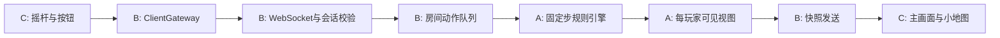

# Light Chase 分工与详细开发设计

日期：2026-10-23；R1。Java、Android Studio、libGDX、电脑 Java 权威服务器、局域网 WebSocket 以及 V1.0 玩法已由用户本轮确认。新增工程参数为建议值，见决策表。

## 1. 分工结论

保留三人分工。A 有 Java Web 基础，适合承担规则状态机及接口整合；B、C 经验较少，应拿到固定契约、小任务和可运行替身，避免让他们自行发明协议。A 工作量最大，因此 B 兼顾客户端网络与服务端启动，C 兼顾地图表现、错误页面、资源和安装验证；A 不包办所有联调。

| 责任 | A：游戏逻辑（用户） | B：联网 | C：Android 展示与输入 |
|---|---|---|---|
| 主要产物 | 纯 Java 规则引擎、几何、地图校验、权限投影、规则测试 | Java 服务器、房间、WebSocket、编解码、心跳、客户端网络适配、传输测试 | Android/libGDX 工程入口、页面、摇杆/按钮、渲染、小地图、生命周期、客户端集成测试 |
| 状态所有权 | 对局内位置、物资、计时、标记、保护、交互、结局 | 连接、会话、房间、角色选择、准备、倒计时、输入排队和传输 | 页面、触摸指针、动画、插值缓冲；不拥有权威玩法状态 |
| 可见信息 | 决定双方可以看到什么；构造允许发送的视图 | 只序列化指定玩家视图；不得序列化完整游戏对象 | 只绘制视图，不计算谁应该被看见 |
| 共同接口 | 审核规则字段和状态 | 维护协议 DTO、Codec、版本与示例 | 审核客户端接口可用性与生命周期 |
| 完成标准 | 离开 Android 和网络也能测试完整规则 | 使用假引擎和假客户端可跑房间/掉线/消息流程 | 使用假网关可演示所有页面与状态 |

共享文件由 B 维护，修改前 A、C 审阅；规则数据由 A 维护；构建顶层配置由 B 与 C 协作确定一个维护人，默认 B。修改别人的模块先提交接口变更说明，不能把问题用复制另一套 DTO/规则解决。

## 2. 推荐工程结构及依赖

开源复用作为工程工作的一部分，按[开源方案](06_开源参考与复用方案.md)执行：优先阅读Fugitive 2D，先确认具体源码及适配方式；当前不换Godot、不整包移植、不声称已经复用。A/B/C分别负责角色与地图、网络、页面与触控的阅读，具体引入写入登记表。

```text
LightChase/
  contracts/       # B 维护，A/C 审核：无 Android/libGDX 依赖的 DTO、枚举、Java 接口
  game-core/       # A：纯 Java 引擎与规则测试
  server/          # B：网络、房间、调度、启动；依赖 game-core + contracts
  client-network/  # B：WebSocket ClientGateway；只依赖 contracts 和网络库
  client-core/     # C：libGDX 页面、输入与渲染；依赖 contracts
  android/         # C：Android 启动与组装 client-core + client-network
  game-data/       # A：地图和参数源；构建复制进服务端与客户端资源
  test-fixtures/   # A/B/C：共同批准的消息/视图/边界场景
  docs/           # 本文档及验收记录
```

目录是待创建的工程约定，不代表已有源码。使用同一仓库的 Gradle 多模块工程；不要三个独立项目最后复制粘贴。contracts 不依赖任何实现模块，game-core 不引用 socket、Activity、Gdx、系统时钟或 UI。client-network 不操作渲染对象。UI 不依赖完整 MatchState 类型。

建议 JDK 17 编译纯 Java 模块，尽量使用普通 POJO/枚举/接口，减少 Android 兼容负担。Android Gradle Plugin、Gradle Wrapper、SDK、libGDX、JSON/WebSocket 库的具体版本在工程初始化时验证兼容并锁定，不能让三人各选“最新版”。初步 minSdk 26，targetSdk/compileSdk 选择建工程时安装的稳定 SDK；这属于待验证配置，不代表已测设备支持。

## 3. 数据流、线程和权威边界



单个房间所有状态变化由同一逻辑线程串行完成。网络线程只验证结构、绑定会话和入队；不直接改坐标、准备状态或结局。先实现单个调度线程服务有限房间，不需要复杂并行架构。客户端网络回调入队，在渲染线程排空队列更新视图，不能从网络线程操作 Stage、Texture 等对象。[libGDX 线程说明](https://libgdx.com/wiki/app/threading)

服务端固定 30 Hz：每秒 30 个逻辑步，连续照射 24 步，隐身 45 步，免疫 30 步，交互 30 步，对局 5400 步，倒计时 90 步。不要以浮点累加 33ms 替代 1/30 秒。使用单调时钟累积器计算应执行步数，时间不受系统日期调整影响；一次最多追赶 5 步，剩余积压保留。持续落后超过 1 秒时终止受影响房间为 SERVER_ABORTED（无胜方），不能悄悄丢步延长比赛或跳过碰撞。异常属于建议处理方案。

快照 15 Hz，即每两步一次；状态跃迁、结算、可见性丢失时立即发送视图。客户端输入 20 Hz，发生按钮边沿或退出时立即发送。服务器输入接受上限建议 60 条/秒/连接，详见契约。30 Hz 是游戏逻辑频率，不是 UI 渲染帧率。

## 4. 房间与生命周期

由 B 维护 `LOBBY → COUNTDOWN → RUNNING → FINISHED`；空房间销毁。RUNNING 时才调用 A 引擎。A 只维护 `ACTIVE → ENDED`。连接与房间不是游戏引擎的职责。

1. 玩家连接握手成功后加入房间；不存在时创建，最多两人。连接会话由服务器生成，无账号。
2. 选择角色，服务器串行占位；同角色不能覆盖，准备前必须有角色。换角色清除双方准备。
3. 两人不同角色且都准备，先确认两人 mapHash/configHash 一致，再进入倒计时。取消准备、换角色、离开均回大厅并清除双方准备。
4. 倒计时结束创建新的 matchId 与引擎，输入置零。客户端必须收到 RUNNING 和新 matchId 才开启控制。
5. 结束后保留终局供当前两名玩家读取。正常连接玩家各自点击返回大厅，更新 roomState.players[].returned；全部仍连接玩家返回后进入大厅，清除准备并保留角色。有人离开则只等待剩余玩家返回。
6. FINISHED 时拒绝第三人加入；剩余玩家返回大厅后才可补位。RUNNING 也拒绝新加入。新连接不得恢复旧会话或旧局。
7. 大厅/倒计时离开不判负；对局单方退出、后台、确认掉线判负。结算后离开不改结果。
8. 同一步双方都失联或明确离开而无法区分先后时，无胜方终止 BOTH_LEFT；不为任一客户端猜胜。正常玩法结束优先于本步异常事件；异常事件早一步已结算则不得覆盖。这是待采用的冲突补充。

后台处理：C 在生命周期回调立即清空触摸与输入，调用 B 网关 `background()`；B 尽力发送通知并关闭连接，服务端收到则立即判负，未送达则按掉线超时处理。不能承诺进程被冻结后通知一定送达。恢复前台进入连接/中断页，不自动续局。[libGDX 生命周期](https://libgdx.com/wiki/app/the-life-cycle)

## 5. 对局逻辑与确定顺序（A）

每步开始 tick 加 1，消耗 B 已按会话序号排好的命令。对每名玩家保留最近有效连续输入，离散按钮边沿不得因输入合并而丢失。

1. 到达保护截止步时更新状态；清除超时输入，收集本步退出/掉线事件。
2. 处理移动；斜向归一化，更新警察非零移动方向，静止保持方向。非零有效移动尝试即取消交互，即使被墙挡住。
3. 计算光照几何、可见性与连续照射。达到 24 步产生一次标记；清零照射进度并中断交互；前两次进入保护，第三次记录抓捕候选。
4. 处理丢弃，取消交互并锁住本次按住状态，直到收到释放后才允许再次拾取。
5. 检查交互目标与连续按住；新一次按下锁定目标，目标变化/无效则清零并要求释放再按。按规则提交拾取/交付，或记录撤离候选。被标记的本步不能提交交互。
6. 胜负判定：本步达到 5400 步超时 > 第三次标记 > 撤离成功；其次处理本步异常判负。只提交一次结果，结束后不再更新。
7. 投影双方视图，包括保护、物资、出口和结局；B 发送，不重新计算规则。

保护时间用绝对截止 tick 表示：若在 k 步被标记，k 到 k+44 隐身，k+45 到 k+74 免疫，k+75 回普通。本步新标记后不能继续累计下一次标记。交互/照射第一步条件成立计入一次；记录单元测试边界防止多算一帧。

## 6. 坐标、碰撞与光线（A 提供一致几何工具）

| 项目 | 建议实现约定 |
|---|---|
| 坐标 | 世界左下为 (0,0)，x 向右、y 向上；格 (col,row) 中心为 (col+0.5,row+0.5)，单位格 |
| 地图 | V1 固定 24×18，墙体为单位闭合方块；地图外不可走且遮光 |
| 角色碰撞 | 半径 0.25 的圆；贴墙允许相切，但不能进入；双方不互相阻挡 |
| 移动 | 输入先校验有限数值与 [-1,1]，向量长度大于 1 时归一化；速度 3 格/秒；每步先 X 后 Y 分轴碰撞，沿墙滑动 |
| 防穿墙 | 每子步位移不超过 0.1 格，移动速度变化后仍需分步；不得只判断终点是否合法 |
| 方向 | headingRad，弧度，0 指右、逆时针正，规范到 [-π,π)；初始朝地图内部 |
| 视线 | 警察中心到小偷中心的线段与任一墙闭方块相交即遮挡；擦墙角也阻挡。交互使用同一规则 |
| 光束 | 中心距 ≤4，夹角绝对值 ≤π/6；距离为 0 时视为角度满足，仍检查保护；比较容差 1e-6 |
| 偷看警察 | abs(dx)≤(8×16/9)/2 且 abs(dy)≤4，包含边界，不受墙遮挡 |
| 镜头 | 世界高 8、宽 128/9，玩家中心不因地图边缘夹紧；外部背景；黑边不响应摇杆 |

服务端决定可见性，客户端只用同地图几何绘制被墙裁切的光束，不能自行延长角色可见时间。可见对象消失立即清除主画面、小地图、插值缓存和携带物表现；禁止外推隐藏对象最后位置。

共享的坐标、线段与墙体相交等纯数学工具由A编写，放入contracts的geometry子包并由B审核共享改动，供game-core与client-core调用。只共享几何和配置模型，不把MatchState或胜负逻辑引入客户端。C可用该工具裁切光束，但不能用本地几何覆盖服务器的opponent可见决定。

## 7. 物资和交互状态

物资 ID M1–M3，状态 GROUND/CARRIED/DELIVERED，原点固定；`everPicked` 首次取走后永久为 true，丢回原点也不复原。小偷携带槽 null 或一个 materialId；交付不可逆。交付点 D1–D3 对应同编号，出口 E1/E2；三个交付完成后同时开放。

每件物资只能恰处于一种状态。GROUND 有地面位置；CARRIED 只有 ownerId，不保留可发送的地面坐标；DELIVERED 没有活动位置和持有者。A 每步可做开发断言，不能同时存在物资实体与携带副本。

交互选择优先级建议为可交付 > 可拾取 > 可撤离；同类型先最近再 ID 字典序。同一次按住绑定 actionType+targetId，不跨目标转移进度。0.8 格内、无遮挡、静止 30 步完成；保护阶段 INVISIBLE 禁止启动；IMMUNE 允许。完成后须松手再按，防止按住自动串联操作。

丢弃为按钮上升沿动作，脚下生成同 ID 地面物资；隐身期间也允许。并发时先丢弃后其他交互，且丢弃强制取消并阻止自动拾回。若脚下已有物资可重叠，仍按最近/ID 选择，不能新增偏移导致穿墙。

## 8. 地图与配置交付

A 提供 `game-data/maps/base.json` 和 `game-data/rules/v1.json`；两份文件的确切字节计算 SHA-256，同一构建复制相同文件进服务端和 Android 资源，避免各端单独格式化后哈希不同。服务端握手校验二者。

地图模型：`mapId:string,mapVersion:int,width:int,height:int,walls:[{col:int,row:int}],spawns:{POLICE:{x,y,headingRad},THIEF:{x,y,headingRad}},materials:[{id,x,y,deliveryId}],deliveries:[{id,x,y}],exits:[{id,x,y}]`。全部字段必填、ID 唯一、整数尺寸，点位为合法中心。具体最终坐标须由 A 设计并与 C 试玩，不用概念图代替数据。

V1 的地图冻结门槛：所有出生和目标能以半径 0.25 的角色到达；交互区域存在合法站位；至少两条可绕行环路；无未定义的重叠点；相互相距足够避免出生立即持续照射；保存可达性检查与试玩记录。联网和 UI 在地图冻结前可用同一标明 TEST_ONLY 的简单测试地图，但不能拿测试地图冒充 V1 正式关卡。

规则配置保存：speed=3、viewHeight=8、viewAspect=16/9、beamRange=4、beamAngleDeg=60、markTicks=24、invisibleTicks=45、immuneTicks=30、interactRange=0.8、interactTicks=30、maxMarks=3、durationTicks=5400、tickRate=30、countdownTicks=90、radius=0.25。广播/心跳/端口属于服务器配置，不混入玩法参数。

## 9. Android 页面与输入（C）

| 页面 | 数据与行为 | 失败路径 |
|---|---|---|
| 连接页 | IP、端口默认 8080、房间号、连接按钮；防重复点击；网络操作不阻塞 UI | 显示空值、非法地址、超时、不兼容、房满等具体原因，可重试 |
| 大厅 | 房间号、连接状态、两个角色槽、双方准备；只按服务端结果更新占位 | 角色冲突提示，离开返回连接页 |
| 倒计时 | 显示服务端剩余时间，操作禁用 | 取消/对方离开回大厅，不本地偷偷开局 |
| 对局 | 统一世界视窗、地形、权限对象、HUD、小地图、摇杆；小偷交互与丢弃 | 网络异常显示中断态，清空输入；不得本地判胜 |
| 结算 | 胜方/无胜方、本人结果、原因、时长、交付数、标记数、返回大厅 | 断线玩家回连接页；不保存历史战绩 |

多点触控：摇杆和交互各自绑定 pointerId；按住交互时仍可推动摇杆，服务端负责取消。丢弃独立按钮，上升沿发送一次。手指离开按钮、touch cancel、切页、后台、连接丢失时发送释放/清空；释放不能等下一次触摸。摇杆死区建议 0.15，死区外将幅度映射到 [0,1]，A 不重复施加第二层死区。角色最终速度幅度可小于最大值，但斜向不得更快。

UI 使用独立适配坐标，主画面世界范围不随手机比例扩大；按钮建议至少 48dp 等效触控区域（项目设计目标，不是已测结果），避开系统边缘与刘海。图形/文字必须能区分物资编号、交付点和出口开闭。不需要精细美术、音效或数据库。

建议首版不做客户端预测，仅对自身与可见敌人位置做 100ms 插值；不做超过最新快照的外推。如果手感不足，再统一评审预测方案，不由 C 单独添加碰撞/胜负副本。光束和警察位置用同一插值时刻；可见性和保护立即服从最新快照。HUD 倒计时可以估计显示，但胜负只取服务端。

## 10. 网络、启动与错误（B）

默认端点 `ws://<host>:8080/game`；房间号建议 `[A-Z0-9]{1,8}`，客户端 trim/转大写后发送，服务端再次验证。host 不接受路径/凭据；端口 1–65535。模拟器、真机地址在运行手册区分。先支持 IPv4/DNS，IPv6 不作为首版验收要求。

需要 Android INTERNET 配置；局域网明文 WebSocket 的开发构建应验证明文策略，不能假设所有目标 SDK 默认允许。把开发网络配置与正式分发配置区分，记录最终 SDK 下的设备结果。[Android 网络安全配置](https://developer.android.com/privacy-and-security/security-config)

连接超时 5 秒；握手超时 3 秒；心跳每秒一次，最后有效收包后 3 秒 SUSPECT，清空输入，5 秒确认掉线。游戏输入超过 250ms 没有刷新即归零，按住交互也取消，不等掉线才停。传输恢复但未判掉线时使用新输入继续；已结算或关闭的会话不恢复。心跳不能延长持续输入租约。

服务端心跳/超时走单调实际时间，不走暂停的客户端时间。客户端 3 秒无有效服务器消息显示连接不稳并禁用输入；5 秒关闭连接，显示中断，不猜胜负。恢复至 5 秒前可恢复网关但必须重新按下控制。

结果保存在房间 FINISHED 状态，发送 GAME_OVER 后，直到玩家回大厅/离开前持续每秒发一次相同结果，幂等处理；不提供跨新连接的旧局恢复。客户端 RESULT_ACK 仅用于停止重复结果，不影响结局。服务端进程退出时不承诺结果持久化。

## 11. 扩展与协作约束

未来可增加地图内容、规则事件、操作输入或显示组件，但每次先写需求和权限矩阵，再改协议版本。V1 不提前加任意脚本执行、通用技能编辑器、钥匙槽或传感器权限。公开协议对象与内部状态分离，比预留几十个空字段更重要。

建议分支 `codex/game-core`、`codex/network`、`codex/android-ui`（可改为团队约定），每个小模块可编译后合并；共享契约先合入再消费。每次 AI 生成代码必须检查修改目录、依赖变化、是否自行简化规则、是否添加客户端权威判定。三人都要能说明自己模块的入口、状态和错误处理。
