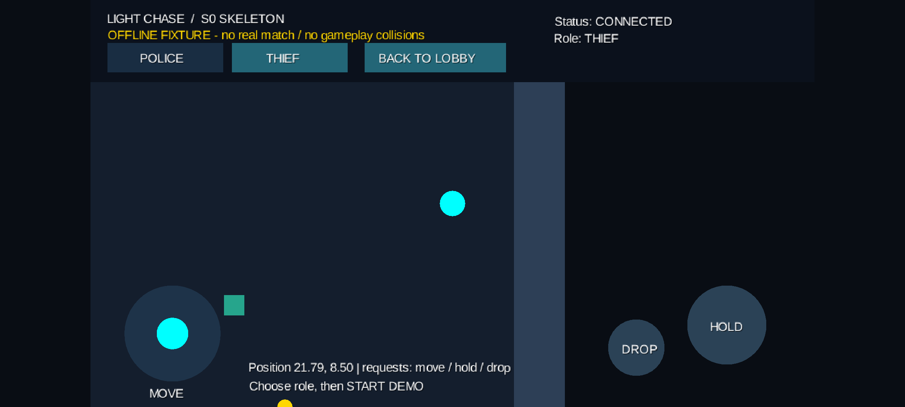

# S0 骨架验证记录

日期：2026-10-23；Windows 本机执行。此次验证支持“骨架可构建、部分模块可独立运行”，不代表 V1 完整游戏验收完成。

## 构建

工作目录：C:\Users\24938\Desktop\Light-Chase。JDK 21.0.8，Gradle 9.6.0，Android SDK 37 / Build Tools 36.0.0。

执行：

```powershell
.\gradlew.bat checkJvm :android:assembleDebug :server:installDist --console=plain
```

结果：BUILD SUCCESSFUL，62 个任务执行。迁移后重新编译了全部模块。产物：

- android/build/outputs/apk/debug/android-debug.apk
- server/build/install/server/
- 各模块 build/reports/tests/test/index.html（生成文件，不入 Git）

构建提示 libgdx.so 未剥离调试符号，按原样打包；另有未来 Gradle 10 不兼容的弃用提示。本轮固定 Gradle 9.6.0，不宣称已支持 Gradle 10。

## 自动化测试

| 测试类 | 数量 | 失败/错误 | 范围 |
|---|---:|---:|---|
| InputFrameTest | 3 | 0/0 | 合法输入、非有限/越界输入 |
| MovementPrototypeTest | 7 | 0/0 | 移动、碰撞、停止、tick/玩家校验、结束与保守角色视图 |
| WireCodecTest | 3 | 0/0 | 包络编码和非法输入 |
| WorldGeometryTest | 5 | 0/0 | 碰撞、线段遮挡、光束角度/射程、矩形视野边界 |
| FakeGatewayTest | 2 | 0/0 | 离线界面替身及输入释放 |
| LobbyIntegrationTest | 3 | 0/0 | 真实本机 WebSocket 两客户端入房/角色冲突、第三人满员、资源哈希不一致 |

总计 23 项，通过 23 项。WorldGeometryTest 是同日补齐共享几何 API 后新增的 5 项，其余 18 项为首轮记录。仍未穷尽接口契约中的协议错误、限流、队列、重开及全部玩法边界。

## 独立进程服务器验证

运行生成的 server.bat 18080，以生成目录中 lib/* 为 classpath 运行 ProbeMain 127.0.0.1 18080。

观察到 CONNECTING → HANDSHAKING → JOINING → CONNECTED，随后输出 PASS: joined PROBE，协议和资源哈希一致。探针退出，测试服务器随后关闭。

此项验证服务器分发脚本及真实 TCP/WebSocket 大厅连接，不验证网络对局。

## Android 模拟器

设备：Pixel_7 AVD，API 37，x86_64，getconf PAGE_SIZE 返回 16384。

- adb install -r 安装最新 debug APK 成功。
- am start -W 冷启动结果 Status: ok，LaunchState: COLD，Activity 为 AndroidLauncher。
- 离线演示的 START DEMO、角色/地图及触摸控件可显示；摇杆向右操作后坐标从 20.50,8.50 改变，松手后摇杆归中。
- 初轮验证过返回桌面再回前台，恢复到离线大厅；不是联机后台判负验证。
- 本轮 AndroidRuntime 错误日志无输出。



截图保留 OFFLINE FIXTURE 标识，不能作为真实联网或完整玩法证明。未做同时双指自动化操作、两台 Android 联机、真机或所有 API 26–37 版本验证。

## 开源声明

用 jar tf 检查 APK，确认 assets/third-party/THIRD_PARTY_NOTICES.md 和 8 份许可证存在；服务器分发目录也包含声明和许可证。本轮没有引入 Fugitive 源码或素材。

## 当前未完成

准备/倒计时、完整规则引擎接入、权限视图算法、物资/撤离、联机结算和重开、Android LAN 运行时授权及真实连接 UI、正式关卡、双机与真机验收。详见 [当前实现与下一步](../development/08_骨架运行与交接.md)。
